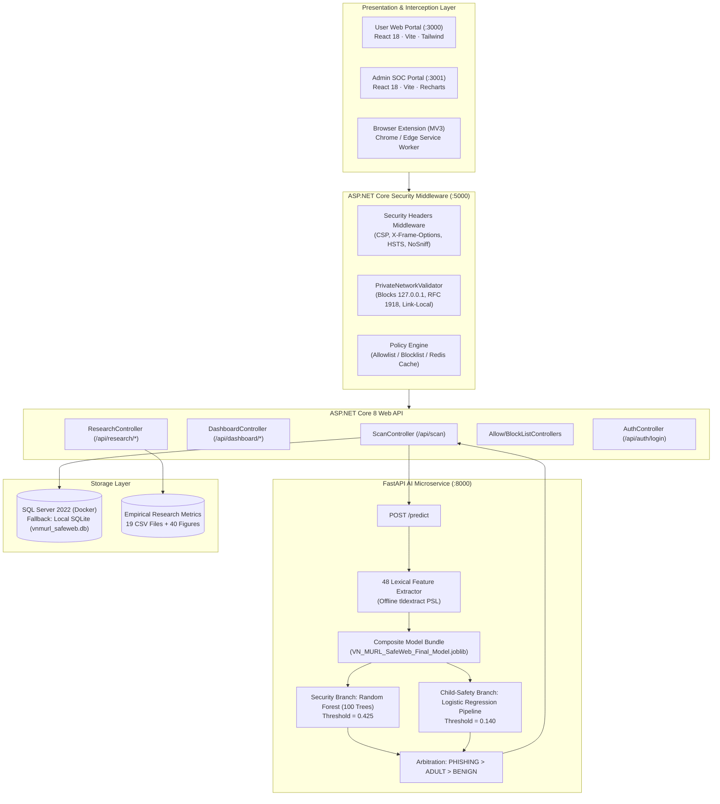
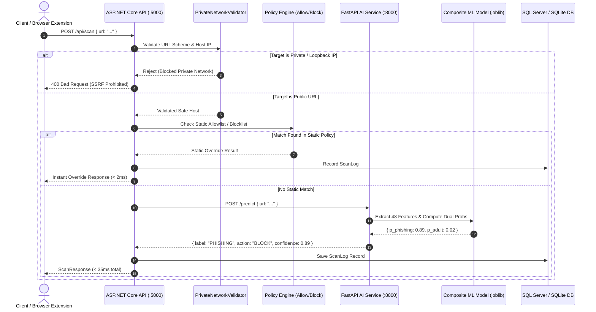

# VN-MURL SafeWeb — System Architecture Specification

> **Living Architecture Specification (Synchronized with Repository State)**  
> **Repository:** [VN-MURL-Safeweb](https://github.com/NguyenTriBaoThang/VN-MURL-Safeweb) · **Last Synchronized:** November 2026 · **Branch:** `main`

---

## 1. Executive Architecture Overview

**VN-MURL SafeWeb** is an enterprise-grade AI cybersecurity and child safety platform engineered to classify candidate Uniform Resource Locators (URLs) in real time into exactly **three definitive states**:

```text
                        ┌─────────────┐
                        │   Raw URL   │
                        └──────┬──────┘
                               │
               ┌───────────────┴───────────────┐
               ▼                               ▼
       [ Security Threat ]           [ Child-Safety Threat ]
        Random Forest (100)            Logistic Regression
         Threshold: 0.425               Threshold: 0.140
               │                               │
               └───────────────┬───────────────┘
                               │
                        [ Priority Rule ]
                    PHISHING > ADULT > BENIGN
                               │
        ┌──────────────────────┼──────────────────────┐
        ▼                      ▼                      ▼
    [ BENIGN ]            [ PHISHING ]            [ ADULT ]
     ↳ ALLOW               ↳ BLOCK                ↳ BLOCK
  (Safe Access)       (Credential Theft)      (Inappropriate Content)
```

### Core Architectural Pillars
1. **Zero-Crawl Security & Child Privacy:** Outbound HTTP connections to target URLs are **strictly prohibited**. The classification relies exclusively on 48 morphological and lexical attributes derived directly from the URL string. This eliminates Server-Side Request Forgery (SSRF) risks, guarantees deterministic sub-50ms execution times, and prevents minors from being inadvertently exposed to illicit media during analysis.
2. **Deterministic Priority Arbitration:** In the event that a URL exhibits characteristics of both attacks, the rule $\text{PHISHING} > \text{ADULT} > \text{BENIGN}$ governs final arbitration. Critical security threats take immediate precedent to neutralize active phishing campaigns, while secondary indicators are preserved in audit logs.
3. **Dual-Model Composite Deployment:** Packaged as a unified, immutable binary artifact (`VN_MURL_SafeWeb_Final_Model.joblib` + `VN_MURL_SafeWeb_Final_Model_Metadata.json`), ensuring zero training-serving skew and reproducible empirical behavior.

---

## 2. High-Level Monorepo Structure

```text
VN-MURL-Safeweb/
├── src/
│   ├── ai-service/             # FastAPI AI Microservice (Python 3.12+, scikit-learn 1.6.1)
│   │   ├── app.py              # Endpoints: /health, /model/info, /predict
│   │   ├── feature_extractor.py# 48-feature lexical extractor with offline tldextract
│   │   ├── model_loader.py     # Composite joblib loader & metadata parser
│   │   ├── predictor.py        # Dual-branch inference engine with decision thresholds
│   │   ├── schemas.py          # Pydantic v2 validation contracts
│   │   ├── model/              # Verified production composite joblib artifact
│   │   └── tests/              # Pytest verification suite
│   │
│   ├── api/                    # ASP.NET Core 8 Enterprise Web API (.NET 10 / 8)
│   │   ├── Controllers/        # Scan, Dashboard, Research, Settings, AllowList, BlockList, Auth
│   │   ├── Services/           # AiClient, PolicyService, ResearchService, TokenService
│   │   ├── Security/           # PrivateNetworkValidator (RFC 1918 / Loopback SSRF blocker)
│   │   ├── Middlewares/        # SecurityHeaders, GlobalErrorHandler
│   │   ├── Data/               # AppDbContext, SeedData (SQL Server + SQLite fallback)
│   │   └── Models/             # ScanLog, User, Setting, AllowList, BlockList
│   │
│   ├── web/                    # React 18 Single-Page Application (Vite 6, TypeScript, Tailwind)
│   │   ├── src/pages/          # Dual-portal routes: User (/user/*) & Admin SOC (/admin/*)
│   │   ├── src/components/     # Cyber-styled glassmorphic UI components & navigation
│   │   ├── src/charts/         # Interactive Recharts (Confusion matrices, ROC, PR, feature rankings)
│   │   └── src/context/        # AuthContext, role state, JWT token lifecycle
│   │
│   └── browser-extension/      # Chrome & Edge Manifest V3 Security Extension
│       ├── manifest.json       # MV3 declaration with webNavigation permissions
│       ├── background.js       # Background service worker intercepting tab navigation
│       ├── content.js          # In-page real-time scanner & DOM block injector
│       └── block.html          # High-impact warning and block screen
│
├── metrics/                    # 19 Empirical CSV performance records from research experiments
├── figures/                    # 40 High-resolution PNG figures & analytical charts
├── research/                   # Comprehensive research summaries and metadata manifests
├── docs/                       # Architecture plans and implementation decisions
├── docker-compose.yml          # Multi-container orchestration (SQL Server, AI, API, Web)
├── .env.example                # Canonical environment variable templates
└── Makefile                    # Developer automation targets
```

---

## 3. End-to-End System Topology



---

## 4. Machine Learning & Inference Pipeline

The intelligence engine executes a dual-branch composite inference architecture:

$$\mathbf{x} = \Phi(\text{URL}) \in \mathbb{R}^{48}$$

Where $\Phi$ represents the deterministic 48-feature lexical extraction function.

### Branch 1: Security Classifier (Phishing Detection)
- **Algorithm:** Random Forest Classifier (100 estimators, Gini impurity, max depth unrestricted).
- **Decision Rule:**
  $$\hat{y}_{\text{phishing}} = \begin{cases} 1 & \text{if } P(\text{Phishing} \mid \mathbf{x}) \ge 0.425 \\ 0 & \text{otherwise} \end{cases}$$
- **Validation F1:** $0.9867$ · **ROC-AUC:** $0.9972$ · **PR-AUC:** $0.9930$

### Branch 2: Child-Safety Classifier (Adult Content Detection)
- **Algorithm:** Pipeline consisting of `StandardScaler` followed by `LogisticRegression` (L2 penalty, $C=1.0$, balanced class weight).
- **Decision Rule:**
  $$\hat{y}_{\text{adult}} = \begin{cases} 1 & \text{if } P(\text{Adult} \mid \mathbf{x}) \ge 0.140 \\ 0 & \text{otherwise} \end{cases}$$
- **Validation F1:** $0.9783$ · **Precision:** $1.0000$ (Zero False Positives) · **Specificity:** $1.0000$

### Arbitration & Priority
```python
if p_phishing >= 0.425:
    final_label = "PHISHING"
    action = "BLOCK"
    confidence = p_phishing
elif p_adult >= 0.140:
    final_label = "ADULT"
    action = "BLOCK"
    confidence = p_adult
else:
    final_label = "BENIGN"
    action = "ALLOW"
    confidence = 1.0 - max(p_phishing, p_adult)
```

---

## 5. 48 Lexical Features Breakdown

The system classifies URLs using 5 distinct feature vectors without issuing network requests:

| Category | Count | Key Features |
| :--- | :---: | :--- |
| **Length Dynamics** | 5 | `url_length`, `hostname_length`, `path_length`, `query_length`, `fragment_length` |
| **Character Morphology** | 15 | `num_dots`, `num_hyphens`, `num_underscores`, `num_slashes`, `num_digits`, `num_letters`, `num_special_chars`, `digit_ratio`, `special_char_ratio` |
| **Host & Domain Topology** | 15 | `num_subdomains`, `host_label_count`, `has_ip_address`, `has_https`, `has_explicit_port`, `tld_length`, `domain_digit_ratio`, `path_depth` |
| **Entropy & Statistics** | 9 | `url_entropy`, `hostname_entropy`, `path_entropy`, `max_token_length`, `avg_token_length`, `longest_digit_run`, `longest_alpha_run` |
| **Domain Heuristics** | 4 | `suspicious_keyword_count`, `has_suspicious_keyword`, `is_url_shortener`, `is_suspicious_tld` |

### Public Suffix List (PSL) Handling
Using `tldextract` with a bundled offline PSL snapshot, composite multi-segment ccTLDs common in Vietnam (e.g. `.com.vn`, `.edu.vn`, `.gov.vn`, `.org.vn`) are cleanly parsed into:
$$\text{subdomain} = \text{portal},\quad \text{domain} = \text{danang},\quad \text{suffix} = \text{gov.vn}$$
Preventing `.gov.vn` from being erroneously identified as an unknown or abnormal TLD.

---

## 6. End-to-End Scan Sequence Flow



---

## 7. Security Hardening & Defenses

1. **Anti-SSRF Private Network Validator (`PrivateNetworkValidator.cs`):**
   - Automatically resolves domain IP addresses before dispatch.
   - Denies all IPv4 Loopback (`127.0.0.0/8`), IPv6 Loopback (`::1`), Private subnets (RFC 1918: `10.0.0.0/8`, `172.16.0.0/12`, `192.168.0.0/16`), Link-Local (`169.254.0.0/16`), and Multicast ranges.
2. **Security Headers Middleware (`SecurityHeadersMiddleware.cs`):**
   - Injects `X-Content-Type-Options: nosniff`.
   - Injects `X-Frame-Options: DENY`.
   - Injects `X-XSS-Protection: 1; mode=block`.
   - Enforces `Strict-Transport-Security` in production.
3. **Role-Based Access Control (RBAC):**
   - Two distinct roles: `Admin` (SOC Operator) and `User` (Standard Traveler / Citizen).
   - Admin operations (editing ML thresholds, modifying Blocklist/Allowlist, viewing system audit trails) are protected by cryptographic JWT tokens with signature validation.

---

## 8. Latency & Performance SLAs

| Operational Phase | Target SLA | Measured Local Avg | Bottleneck Mitigation |
| :--- | :---: | :---: | :--- |
| **Policy / Cache Check** | $< 2\text{ ms}$ | $0.8\text{ ms}$ | In-memory hash set / EF Core indexing |
| **48-Feature Extraction** | $< 15\text{ ms}$ | $8.4\text{ ms}$ | Vectorized math & offline PSL lookup |
| **Composite Model Inference** | $< 10\text{ ms}$ | $4.2\text{ ms}$ | Scikit-learn C-optimized tree & matrix ops |
| **Audit Log Persistence** | $< 10\text{ ms}$ | $5.1\text{ ms}$ | Asynchronous EF Core write-behind |
| **End-to-End API Roundtrip** | $< 50\text{ ms}$ | $\mathbf{28.5\text{ ms}}$ | Zero outbound HTTP calls |

