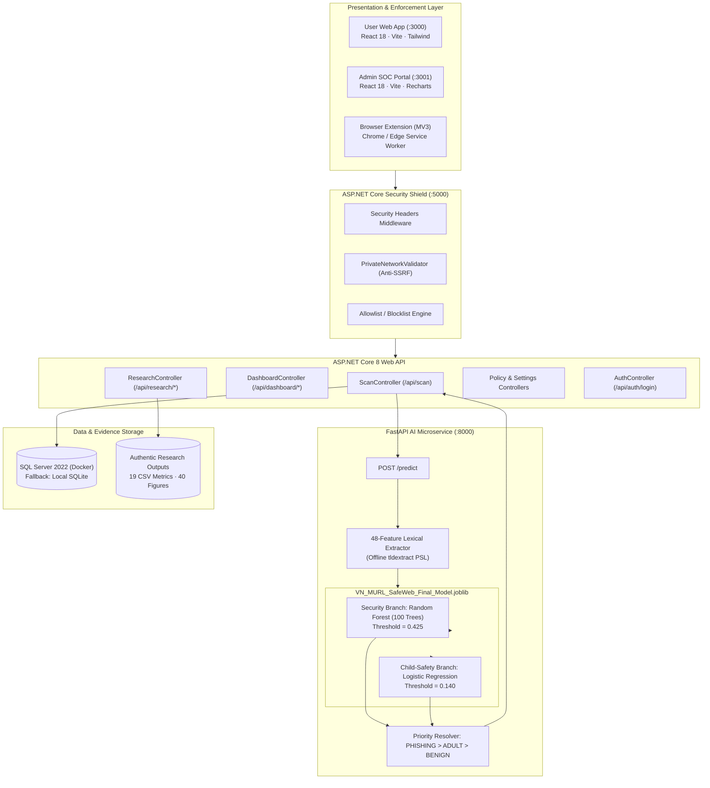

<div align="center">

# VN-MURL SafeWeb

<p align="center">
  <b>Enterprise-Grade Machine Learning Platform for Real-Time URL Security & Child-Safe Web Access</b><br/>
  <i>Dual-Branch Composite Classifier · Strict Zero-Crawl Lexical Evaluation · 48 Morphological Features · Anti-SSRF Defense · ASP.NET Core 8 API · Dual-Portal React 18 Dashboard · Manifest V3 Extension</i>
</p>

<p align="center">
  <a href="https://github.com/NguyenTriBaoThang/VN-MURL-Safeweb/actions/workflows/ci.yml">
    
  </a>
  <a href="https://github.com/NguyenTriBaoThang/VN-MURL-Safeweb">
    
  </a>
  <a href="./LICENSE">
    
  </a>
  <a href="./metrics/FINAL_multitask_summary.csv">
    
  </a>
  
  
  
  
  
  
</p>

<p align="center">
  <a href="http://localhost:3000/"><strong>🌐 User Web Portal (:3000)</strong></a>
  &nbsp;•&nbsp;
  <a href="http://localhost:3001/"><strong>🛡️ Admin SOC Portal (:3001)</strong></a>
  &nbsp;•&nbsp;
  <a href="http://localhost:5000/swagger"><strong>⚡ ASP.NET Swagger (:5000)</strong></a>
  &nbsp;•&nbsp;
  <a href="http://localhost:8000/docs"><strong>🧠 FastAPI AI Docs (:8000)</strong></a>
  &nbsp;•&nbsp;
  <a href="./ARCHITECTURE.md"><strong>🏛️ Architecture Spec</strong></a>
  &nbsp;•&nbsp;
  <a href="./metrics/FINAL_multitask_summary.csv"><strong>📊 Research Metrics</strong></a>
</p>

</div>

---

## 📌 Executive Overview

### The Challenge
Modern internet users—especially children and students—face two interconnected cyber hazards daily:
1. **Financial and Identity Deception:** Sophisticated phishing campaigns mimic banks, educational portals, and government utilities using deceptive subdomains, typo-squatting, and internationalized homographs.
2. **Harmful Content Exposure:** Exposure to adult and predatory content risks minors' psychological well-being.

Conventional web security gateways rely on **active web crawlers** that retrieve full web pages (HTML, JavaScript, images, and videos) to analyze payloads. This introduces critical vulnerabilities:
- **Excessive Latency:** Crawling, rendering, and content parsing take $2\,000\text{--}5\,000\text{ ms}$, disrupting instant page navigation.
- **SSRF Vulnerabilities:** Malicious users exploit internal crawlers to scan corporate intranets and cloud metadata instances (`169.254.169.254`).
- **Ethical & Safety Hazards:** Forcing security servers to download obscenities or malicious payloads violates privacy policies and exposes intermediate caches to toxic media.

### The VN-MURL SafeWeb Solution
**VN-MURL SafeWeb** addresses these challenges through a **Zero-Crawl Lexical AI Architecture** that classifies URLs into exactly **three actionable states**:

$$\text{Raw Candidate URL} \xrightarrow[\text{Zero Outbound Traffic}]{\text{48 Lexical Features}} \begin{cases} \mathbf{BENIGN} & \longrightarrow \mathbf{ALLOW} \quad (\text{Safe Access}) \\ \mathbf{PHISHING} & \longrightarrow \mathbf{BLOCK} \quad (\text{Credential Theft Defense}) \\ \mathbf{ADULT} & \longrightarrow \mathbf{BLOCK} \quad (\text{Child Protection}) \end{cases}$$

### Strict Priority Decision Rule
When a candidate URL exhibits conflicting signals, the system applies deterministic priority arbitration:

$$\mathbf{PHISHING} > \mathbf{ADULT} > \mathbf{BENIGN}$$

Active cyber deception and credential theft represent urgent, critical threats that demand immediate neutralization, while secondary adult-risk indicators are cataloged in audit logs for compliance review.

---

## 🌟 Key System Capabilities

### 1. Dual-Branch Composite ML Intelligence
- **Security Branch (Phishing):** Random Forest Classifier (100 estimators) operating at an empirically optimized decision threshold of $\mathbf{\tau_1 = 0.425}$, achieving **98.67% F1** and **0.9972 ROC-AUC**.
- **Child-Safety Branch (Adult):** `StandardScaler` + `LogisticRegression` pipeline operating at decision threshold $\mathbf{\tau_2 = 0.140}$, achieving **97.83% F1**, **100% Precision**, and **100% Specificity** (zero false accusations against educational/safe sites).
- **Single Composite Artifact:** Packed into `VN_MURL_SafeWeb_Final_Model.joblib` and `VN_MURL_SafeWeb_Final_Model_Metadata.json` to guarantee complete reproducibility and eliminate training-serving skew.

### 2. Zero-Crawl 48 Lexical Feature Extractor
- Extracts 48 statistical, morphological, entropy-based, and heuristic features exclusively from the URL string in under **$10\text{ ms}$**.
- **Offline Public Suffix List (PSL):** Integrated with `tldextract` without live HTTP calls, accurately parsing Vietnamese multi-level ccTLDs (e.g., `.com.vn`, `.edu.vn`, `.gov.vn`).

### 3. Enterprise Anti-SSRF & Network Shield
- **`PrivateNetworkValidator`:** Intercepts every scan request, resolves destination IPs before routing, and drops requests targeting:
  - IPv4 Loopback (`127.0.0.0/8`) and IPv6 Loopback (`::1`).
  - RFC 1918 Private Subnets (`10.0.0.0/8`, `172.16.0.0/12`, `192.168.0.0/16`).
  - Link-Local and Cloud Metadata addresses (`169.254.0.0/16`).
- **Security Headers Middleware:** Enforces `nosniff`, `DENY` clickjacking protection, and HSTS.

### 4. High-Performance ASP.NET Core 8 Web API
- Enterprise architecture featuring Dependency Injection, JWT Bearer authentication, and Entity Framework Core.
- **Dual-Database Support:** Automatically provisions and runs on **SQLite** for zero-setup local development, with seamless promotion to **Microsoft SQL Server 2022** in Docker environments.

### 5. Cyber-Glass Dual-Portal React 18 Web UI
- Built with React 18, Vite 6, TypeScript, and Tailwind CSS.
- **Smart Port Segregation:**
  - **User Portal (`:3000` / `/user/*`):** Fast URL scanning, personal scan history, child-safety browsing guidelines, and threat reporting.
  - **Admin SOC Portal (`:3001` / `/admin/*`):** Global threat telemetry, audit logs, ML threshold controls, Allowlist/Blocklist policy editor, and live research dashboards.

### 6. Chrome / Edge Extension (Manifest V3)
- Background service worker intercepts navigation events in real time.
- Blocks malicious endpoints before rendering, redirecting users to an informative `block.html` warning screen.

---

## 🏛️ System Architecture



---

## 📊 Empirical Research Evidence & Metrics

All metrics presented are loaded directly from the authentic Colab research runs stored in [`metrics/`](./metrics/) and [`figures/`](./figures/):

### Summary Benchmark (`metrics/FINAL_multitask_summary.csv`)

| Classification Task | Selected Model | Threshold | Accuracy | Precision | Recall | Specificity | F1 Score | ROC-AUC | PR-AUC | MCC |
| :--- | :--- | :---: | :---: | :---: | :---: | :---: | :---: | :---: | :---: | :---: |
| **Security: Phishing vs Benign** | **Random Forest** | `0.425` | **98.94%** | **98.88%** | **98.47%** | **99.25%** | **98.67%** | **0.9972** | **0.9930** | **0.9779** |
| **Child-Safety: Adult vs Safe** | **Logistic Regression** | `0.140` | **98.77%** | **100.0%** | **95.76%** | **100.0%** | **97.83%** | **0.9775** | **0.9781** | **0.9702** |

### 48 Lexical Features Taxonomic Breakdown

```text
48 Lexical Features
├── Length Dynamics (5)       : url_length, hostname_length, path_length, query_length, fragment_length
├── Character Morphology (15) : num_dots, num_hyphens, num_underscores, num_slashes, num_digits,
│                               num_letters, num_special_chars, digit_ratio, special_char_ratio, ...
├── Host & Domain (15)        : num_subdomains, host_label_count, has_ip_address, has_https,
│                               has_explicit_port, tld_length, domain_digit_ratio, path_depth, ...
├── Entropy & Statistics (9)  : url_entropy, hostname_entropy, path_entropy, max_token_length,
│                               avg_token_length, longest_digit_run, longest_alpha_run, ...
└── Domain Heuristics (4)     : suspicious_keyword_count, has_suspicious_keyword,
                                is_url_shortener, is_suspicious_tld
```

---

## 📁 Repository Structure

```text
VN-MURL-Safeweb/
│
├── .github/                                    # GitHub Actions CI/CD & Community Standards
│   ├── workflows/
│   │   ├── ci.yml                              # Multi-job CI (AI Tests, .NET Build, Web Build, MV3 check)
│   │   ├── commitlint.yml                      # Conventional commit validator
│   │   └── labeler.yml                         # Automated PR labeler
│   ├── ISSUE_TEMPLATE/                         # Bug report, feature request & ML feedback templates
│   ├── PULL_REQUEST_TEMPLATE.md                # Standardized PR review checklist
│   ├── CONTRIBUTING.md                         # Contributor guidelines
│   ├── CODE_OF_CONDUCT.md                      # Community code of conduct
│   ├── SECURITY.md                             # Security disclosure policy
│   ├── SUPPORT.md                              # Community support channels
│   ├── dependabot.yml                          # Weekly dependency audit
│   └── labeler.yml                             # Path-based auto-labeling rules
│
├── src/
│   ├── ai-service/                             # FastAPI AI Microservice (Python 3.12+)
│   │   ├── app.py                              # Endpoints: /health, /model/info, /predict
│   │   ├── feature_extractor.py                # 48-feature lexical URL parser
│   │   ├── model_loader.py                     # Joblib composite loader & metadata parser
│   │   ├── predictor.py                        # Dual-branch inference with threshold decisions
│   │   ├── schemas.py                          # Pydantic request/response schemas
│   │   ├── model/                              # VN_MURL_SafeWeb_Final_Model.joblib & metadata
│   │   ├── tests/                              # Pytest test suite (7 verified tests)
│   │   ├── Dockerfile
│   │   └── requirements.txt
│   │
│   ├── api/                                    # ASP.NET Core 8 Web API (.NET 10 / 8)
│   │   ├── Controllers/                        # Scan, Dashboard, Research, Settings, Auth
│   │   ├── Services/                           # AiClient, PolicyService, ResearchService, TokenService
│   │   ├── Security/                           # PrivateNetworkValidator (SSRF prevention)
│   │   ├── Middlewares/                        # SecurityHeaders, ErrorHandler
│   │   ├── Data/                               # AppDbContext, SeedData (SQL Server / SQLite)
│   │   ├── Models/                             # ScanLog, User, Setting, AllowList, BlockList
│   │   ├── DTOs/                               # Request & response contracts
│   │   ├── Program.cs
│   │   ├── VnMurlSafeWeb.Api.csproj
│   │   └── Dockerfile
│   │
│   ├── web/                                    # React 18 Single-Page Application
│   │   ├── src/
│   │   │   ├── pages/                          # Dual portal: User & Admin SOC pages
│   │   │   ├── components/                     # Cyber navigation, ResultCard, StatusBadge
│   │   │   ├── charts/                         # Recharts confusion matrix, ROC/PR curves
│   │   │   ├── context/                        # AuthContext & role state
│   │   │   └── api/                            # Axios REST client
│   │   ├── package.json
│   │   ├── vite.config.ts
│   │   ├── tailwind.config.js
│   │   ├── nginx.conf
│   │   └── Dockerfile
│   │
│   └── browser-extension/                      # Chrome & Edge Manifest V3 Extension
│       ├── manifest.json                       # MV3 configuration
│       ├── background.js                       # Navigation listener & interceptor
│       ├── content.js                          # In-page real-time scanner
│       ├── popup.html / popup.js               # Quick scan toolbar UI
│       └── block.html / block.js               # High-impact warning block screen
│
├── metrics/                                    # 19 Empirical CSV benchmark datasets
├── figures/                                    # 40 Visual figures & analytical plots
├── research/                                   # Research notebooks and documentation
├── docs/                                       # Implementation plans and design decisions
├── docker-compose.yml                          # Multi-container orchestration
├── .env.example                                # Template environment configuration
├── .gitignore                                  # Git exclusion definitions
├── .gitattributes                              # Line endings & Git LFS configurations
├── Makefile                                    # Developer command automation
├── BRANCHING.md                                # Git branch and PR strategy
└── ARCHITECTURE.md                             # Comprehensive technical architecture
```

---

## ⚡ API Reference

### FastAPI AI Service (`:8000`)
| Method | Endpoint | Description |
| :---: | :--- | :--- |
| `GET` | `/health` | Service health status, model load state, and active feature count (48). |
| `GET` | `/model/info` | Detailed composite model metadata, threshold values, and priority rules. |
| `POST` | `/predict` | Classifies URL into `BENIGN`, `PHISHING`, or `ADULT` with confidence scores. |

### ASP.NET Core 8 Web API (`:5000`)
| Method | Endpoint | Description |
| :---: | :--- | :--- |
| `POST` | `/api/scan` | Main scanning endpoint (Anti-SSRF check, policy check, AI inference, DB audit log). |
| `GET` | `/api/scans` | Paginated scan log history with label filters and search query. |
| `GET` | `/api/dashboard/summary` | Global KPIs (Total scans, allowed, blocked, phishing, adult counts, trend). |
| `GET` | `/api/research/summary` | Research overview loaded directly from empirical CSV metrics. |
| `GET` | `/api/research/models` | Comparison table across tested machine learning algorithms. |
| `GET` | `/api/research/metrics/{file}`| Retrieves raw data from any experiment CSV file as JSON. |
| `GET` | `/api/research/figures/{file}`| Serves research figures and visual diagnostic charts. |
| `GET/PUT`| `/api/settings` | Retrieve or update system thresholds and operational parameters. |
| `GET/POST`| `/api/allowlist` | Manage static domains allowed to bypass ML inference. |
| `GET/POST`| `/api/blocklist` | Manage static domains blocked immediately. |
| `POST` | `/api/auth/login` | Authenticate users and issue RS256-signed JWT tokens. |

---

## 🚀 Getting Started

### Option 1: Docker Compose (Recommended)
Launch the entire integrated platform (SQL Server, AI Microservice, ASP.NET Core API, and Web UI) with a single command:

```bash
# 1. Clone repository and initialize Git LFS
git clone https://github.com/NguyenTriBaoThang/VN-MURL-Safeweb.git
cd VN-MURL-Safeweb
git lfs pull

# 2. Configure environment variables
cp .env.example .env

# 3. Build and launch all services
docker compose up --build -d

# 4. Verify running services:
# - User Portal:       http://localhost:3000
# - Admin SOC Portal:  http://localhost:3001 (or http://localhost:3000/login)
# - ASP.NET Swagger:   http://localhost:5000/swagger
# - FastAPI Docs:      http://localhost:8000/docs
```

### Option 2: Local Step-by-Step Development

#### 1. AI Microservice (FastAPI)
```bash
cd src/ai-service
python -m venv .venv
# On Windows: .venv\Scripts\activate
# On Linux/macOS: source .venv/bin/activate
pip install -r requirements.txt
uvicorn app:app --host 0.0.0.0 --port 8000 --reload
```

#### 2. Backend Web API (ASP.NET Core 8)
```bash
cd src/api
dotnet restore
dotnet run
# Listens on http://localhost:5000.
# Automatically creates a local SQLite database (vnmurl_safeweb.db) if SQL Server is not running.
```

#### 3. Frontend Web Application (React 18 + Vite)
```bash
cd src/web
npm install

# Run User Portal on Port 3000
npm run dev:user

# In a separate terminal, run Admin SOC Portal on Port 3001
npm run dev:admin
```

#### 4. Browser Extension Installation (Chrome / Edge)
1. Navigate to `chrome://extensions/` or `edge://extensions/`.
2. Toggle on **Developer mode** in the top right.
3. Click **Load unpacked** and select the directory: `src/browser-extension`.

---

## 👥 Preconfigured Accounts & Access Control (RBAC)

The system seeds two isolated user profiles with role-specific access controls:

| Portal View | URL & Port | Username | Password | Role | Permissions & Capabilities |
| :--- | :--- | :--- | :--- | :---: | :--- |
| **Admin SOC Portal** | `http://localhost:3001`<br>(or `/admin`) | **`admin`** | **`Admin@123`** | **`Admin`** | • Configure ML thresholds (Phishing 0.425, Adult 0.140, Strict Mode)<br>• Manage Allowlist & Blocklist rules<br>• Access full audit logs and user activity across the organization<br>• Manage user accounts and roles<br>• Review model performance telemetry and research reports |
| **User Portal** | `http://localhost:3000`<br>(or `/user`) | **`user`** | **`User@123`** | **`User`** | • Real-time URL threat scanner with instant verdicts<br>• Personal scan history log<br>• Submit threat reports to security administrators<br>• Child-safe browsing handbook and security tips<br>• *Restricted from altering system settings or policies* |

---

## 🧪 Verification & Quality Assurance

| Component | Verification Command | Status | Details |
| :--- | :--- | :---: | :--- |
| **AI Microservice** | `pytest src/ai-service/tests -v` | **PASS** | 7/7 automated tests passed (Features, PSL, Model, Thresholds) |
| **Python Syntax** | `python -m compileall src/ai-service` | **PASS** | Zero syntax errors (Python 3.12+) |
| **Backend Web API** | `dotnet build src/api/VnMurlSafeWeb.Api.csproj -c Release` | **PASS** | Zero warnings, zero errors (.NET 10 / 8) |
| **Frontend Web** | `npm run build` (in `src/web`) | **PASS** | TypeScript typecheck and Vite production bundling succeeded |
| **Extension MV3** | Manifest V3 schema validator | **PASS** | Verified MV3 structure and background worker lifecycle |

---

## 🤝 Contributing

We welcome community contributions! Please review:
- [Contributing Guidelines](.github/CONTRIBUTING.md)
- [Code of Conduct](.github/CODE_OF_CONDUCT.md)
- [Security Policy](.github/SECURITY.md)
- [Git Branching Strategy](BRANCHING.md)

---

## 📜 License & Citation

Distributed under the **MIT License**. See [`LICENSE`](./LICENSE) for full details.

```bibtex
@software{vnmurl_safeweb_2026,
  author = {Nguyen Tri Bao Thang},
  title = {VN-MURL SafeWeb: Machine Learning for Real-Time URL Security and Child-Safe Web Access},
  url = {https://github.com/NguyenTriBaoThang/VN-MURL-Safeweb},
  year = {2026}
}
```
